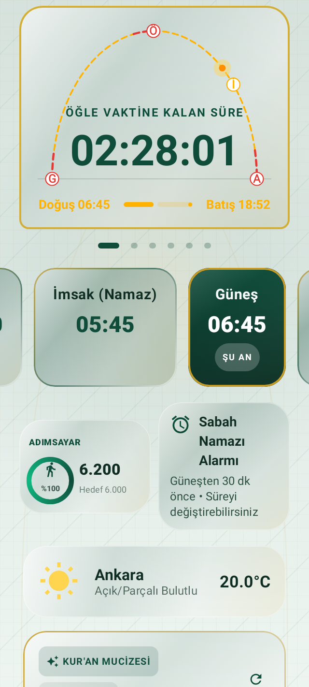
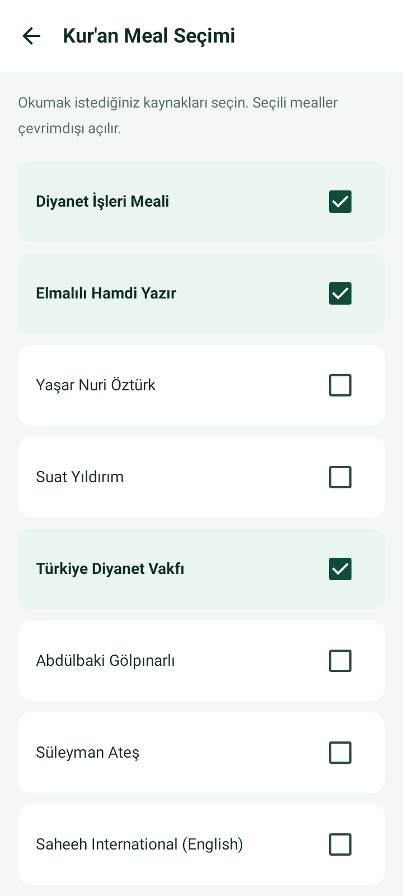
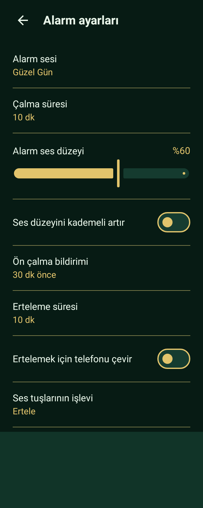
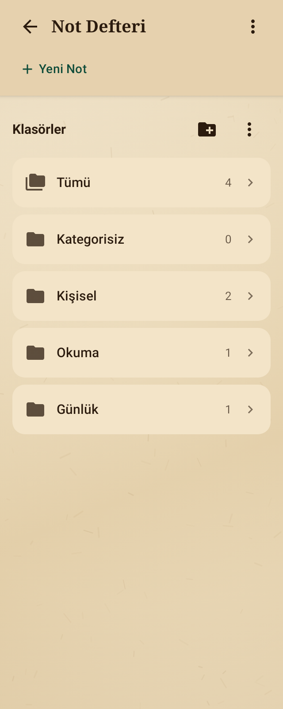
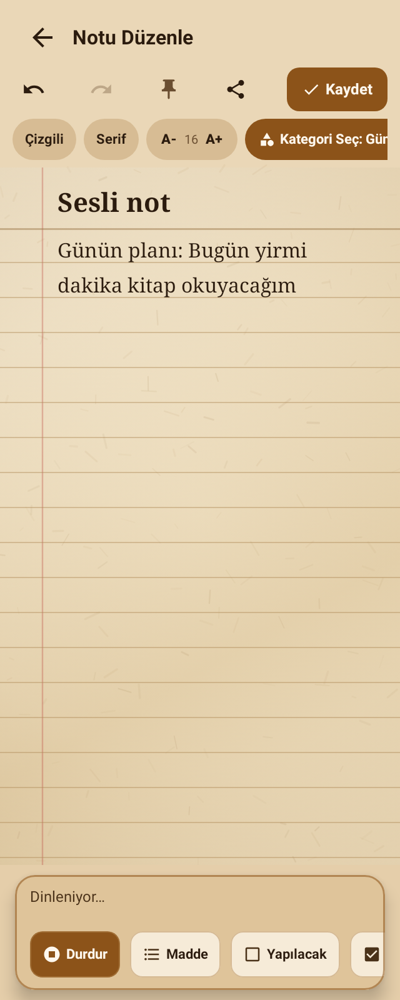
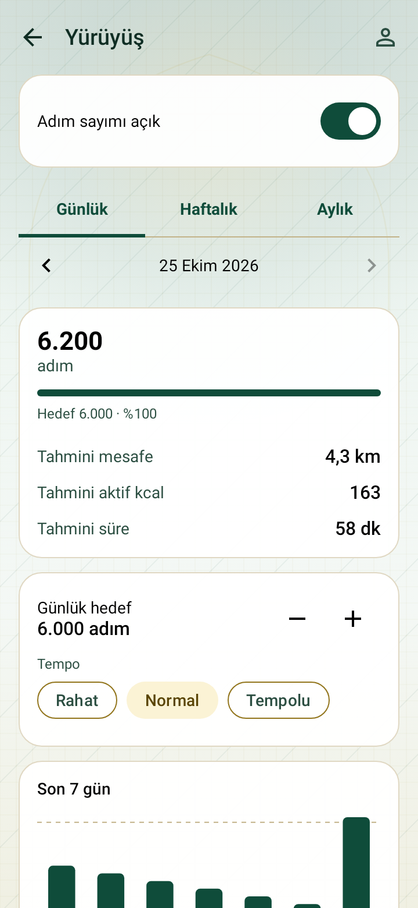
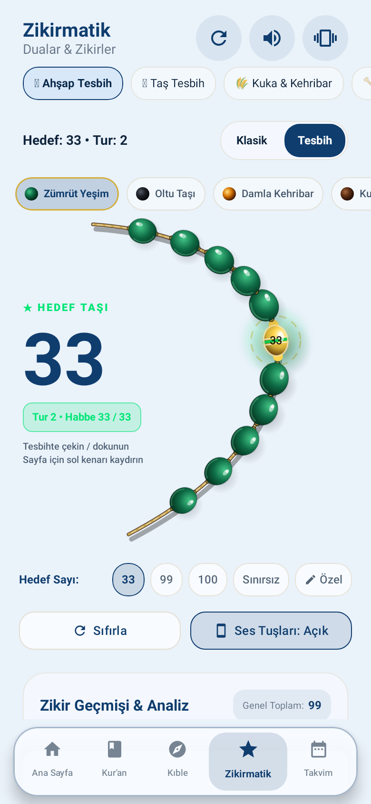
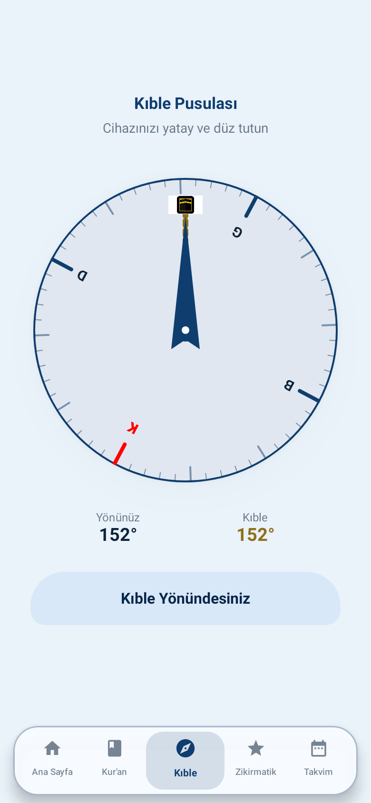

# Vakit Pro

Vakit Pro; namaz vakitlerini takip etmek, Kur’an okumak, bir konu hakkında ayet aramak ve günlük notlar tutmak için geliştirilen Android uygulamasıdır. Sabah Namazı Alarmı, canlı geri sayım, kıble pusulası, zikirmatik ve yürüyüş takibi aynı uygulamada bulunur.

Kur’an metinleri, seçilebilir mealler, Türkçe okunuş ve anlam odaklı fihrist cihazda çalışır. Ana sayfada sıradaki vakit, hava durumu, adımsayar ve sabah alarmı görülebilir; diğer araçlara uygulama menüsünden erişilir.

[Son sürümü ve APK’yi indir](https://github.com/mcelikart/vakitbox-pro/releases/latest)

## Ekran görüntüleri

<p align="center">
  
  
</p>
<p align="center">
  
  
</p>
<p align="center">
  
  
</p>
<p align="center">
  
  
</p>

## Özellikler

### Namaz vakitleri ve bildirimler

- Seçilen konuma göre günlük namaz vakitleri ve bir sonraki vakte kalan süre.
- Vakit girmeden 10 dakika önce ve vakit başladığında bildirim.
- Bildirim alanında sürekli görünen geri sayım; vakit bildirimi geri sayımın altında kalır ve beş dakika sonra otomatik kapanır.
- Durum çubuğunda çerçevesiz, daha kalın rakamlarla kalan-süre göstergesi. Boyutu Android’in durum çubuğu alanıyla sınırlıdır.
- Konum seçimi ve farklı vakit hesaplama yöntemleri.

### Sabah Namazı alarmı

- Alarm saatini güneş doğuşuna göre her gün yeniler.
- Varsayılan alarm güneş doğuşundan 30 dakika öncedir; bu süre değiştirilebilir ve birden fazla alarm kurulabilir.
- Telefonun varsayılan alarm sesi veya seçilen bir zil sesiyle çalar; kilit ekranında erteleme ve kapatma kontrolleri sunar.
- Sağ üst menüdeki Ayarlar bölümünden çalma süresi, erteleme süresi, alarm ses düzeyi, kademeli ses artışı ve sessiz ön bildirim ayarlanır.
- Destekleyen cihazlarda telefonu çevirerek erteleme; alarm ekranında ses tuşuyla erteleme, kapatma veya ses düzeyini değiştirme seçenekleri vardır.
- Telefon sessizdeyken alarm ses kanalını kullanır. Alarm kanalı kapalıysa çalma sırasında duyulabilir düzeye getirir; kullanıcı sesi değiştirmediyse önceki düzeyi geri yükler. Telefon tamamen kapalıyken açılıp alarm çalma, telefon üreticisinin Saat uygulamasına özgüdür.

### Çevrimdışı Kur’an fihristi

- Sorguyu yalnızca kelime eşleşmesiyle aramaz; aranan konunun anlamına yakın ayetleri cihazda sıralar.
- Arama internet bağlantısı, API veya API anahtarı istemez. Model ve arama verileri uygulamayla birlikte gelir.
- 114 sure ve 6.236 ayet üzerinde çalışır; sonuçlar sure ve ayet bilgisiyle gösterilir.

### Kur’an okuma ve diğer araçlar

- 114 surenin ve 6.236 ayetin Arapça metni, seçilebilir mealleri ve Türkçe okunuşu uygulamayla birlikte gelir; metin okumak için API veya internet gerekmez.
- Diyanet İşleri, Elmalılı, Türkiye Diyanet Vakfı, Yaşar Nuri Öztürk, Suat Yıldırım, Abdülbaki Gölpınarlı, Süleyman Ateş, Saheeh International ve Rowwad kaynakları arasından seçim yapılabilir.
- Seçilen mealler ayrı sekmelerde gösterilir. Kaynak kimlikleri, mevcut dipnotlar ve ayet kayıtları korunur.
- Sesli tilavet ve Türkçe meal seslendirme desteği.
- Kıble pusulası, imsakiye ve hicrî takvim.
- Zikir sayacı, günlük adım sayar, namaz öğrenme rehberi ve kaza namazı takibi.
- Yakındaki camileri bulma, dua ve sure içerikleri, Esma-ül Hüsna ve zekât hesaplama.
- Tema seçenekleri, ana ekran araç takımı ve farklı ekran boyutlarına uyumlu arayüz.

### Yürüyüş takibi

- Günlük, haftalık ve aylık adım özeti; hedef, grafik ve geçmiş.
- Profile göre tahmini mesafe, aktif kalori ve süre.
- Tempo seçimi, profil/kalibrasyon ve yürüyüş kaydı.
- Adım sayımını açma/kapatma ve gerekli cihaz izinlerine erişim.

### Not defteri

- Klasörleri açarak notlar arasında gezinme, klasör başına not sayısı ve notlarda arama.
- Klasör ekleme, yeniden adlandırma ve menüden silme; klasör silinirken notlar Kategorisiz altında korunur.
- Not editöründeki mikrofonla doğrudan sesle yazma; mevcut metin korunarak imleç konumuna ekleme ve tek dokunuşla dinlemeyi durdurma.
- Arama, sabitleme, yazı düzenleme ve kaydetme kontrolleri.

Kur’an metinleri ve fihrist araması cihazda çalışır. Hava durumu, harita, sesli tilavet ve isteğe bağlı asistan gibi bazı özellikler internet bağlantısı gerektirebilir. Sesle not yazma mikrofon izni ve cihazda konuşma tanıma desteği gerektirir; cihazın desteklediği yerde yerel tanıma kullanılır.

## Kurulum

Yayımlanan kurulum paketleri için [GitHub Releases](https://github.com/mcelikart/vakitbox-pro/releases) sayfasına bakın. Kaynak kodunu Android Studio ile açabilir veya JDK 17 ve Android SDK kurulu bir ortamda derleyebilirsiniz.

Arama modeli Git LFS ile saklanır. Depoyu klonladıktan sonra model dosyasını indirin:

```sh
git lfs install
git lfs pull
```

Debug APK üretmek için:

```sh
./gradlew assembleDebug
```

Minify ve kaynak küçültmesi etkin, telefonda denemeye uygun APK için:

```sh
./gradlew assemblePreview
```

`assemblePreview` çıktısı `app/build/outputs/apk/preview/app-preview.apk` konumunda oluşur.

## Geliştirme bilgileri

- Android için Kotlin, Jetpack Compose ve Material 3.
- Kur’an konu araması için cihazda çalışan ONNX Runtime modeli.
- Minimum Android sürümü: Android 7.0 (API 24).
- Sürüm numarası ve Android yapı kodunun tek kaynağı `version.properties` dosyasıdır. Kaynak değişikliklerini paketlerken yama sürümü ve yapı kodu otomatik ilerler; ayrıntılar için [VERSIONING.md](VERSIONING.md) dosyasına bakın.
- Testler: `./gradlew testDebugUnitTest`.

## Kaynaklar ve lisanslar

Kur’an metni, Rowwad meali, arama modeli ve kaynak notları `app/src/main/assets/quran_search` altında bulunur. Diğer mealler ve Türkçe okunuş `app/src/main/assets/quran_reading` altında, kaynak kimlikleri ve dosya özetleriyle paketlenir. Kaynak metinleri yeniden yazılmaz; her dosyanın 114 sure ve 6.236 ayet sırası doğrulanır.

Meal ve okunuş dosyalarının kaynağı [Tanzil çevirileri](https://tanzil.net/trans/) sayfasıdır. Tanzil bu çevirileri gayriticari kullanım için sunar; ticari kullanımda çevirmen/yayıncı izni gerekir. Arapça metnin, çevirilerin ve arama modelinin lisansları farklıdır. Her iki dizindeki `NOTICE` ve lisans dosyalarını dağıtım sırasında koruyun. Kaynaklar uygulamanın Hakkında ekranında da gösterilir.

Okuyucu veri dosyalarını yeniden hazırlamak için:

```sh
python3 scripts/prepare-quran-reader.py
python3 scripts/test_quran_reader_corpus.py
```

## İletişim

Sorular ve geri bildirim için: [mcelik.art@gmail.com](mailto:mcelik.art@gmail.com)
